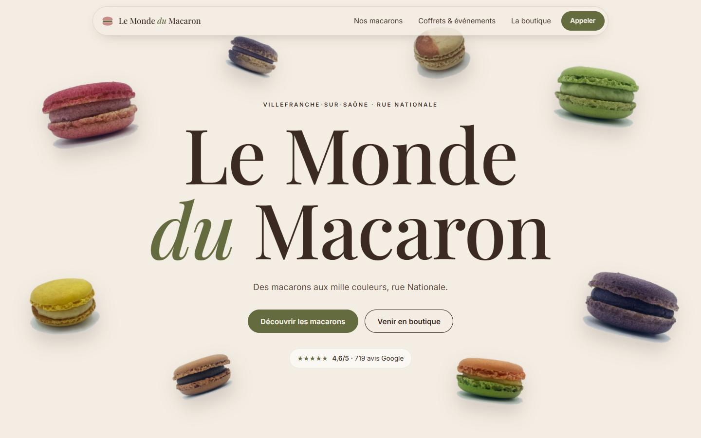
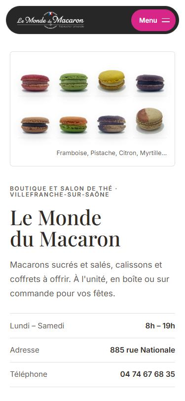
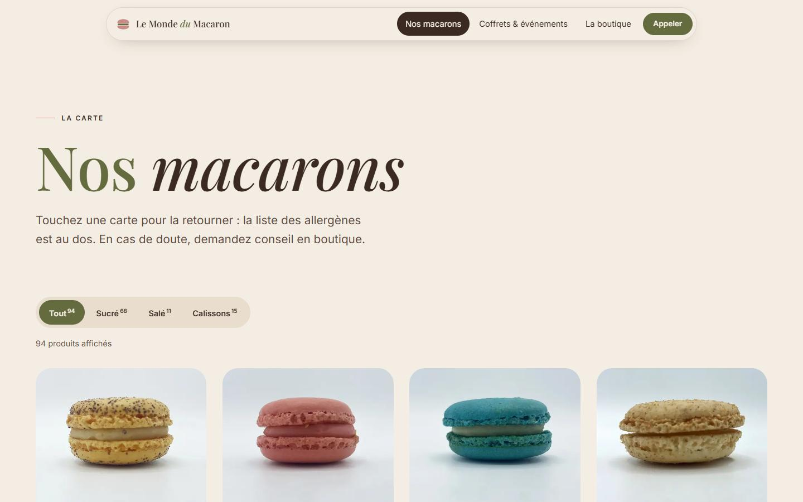
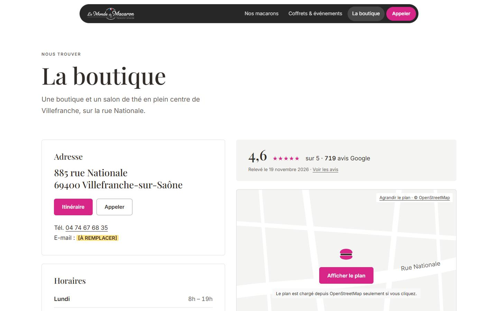

# Le Monde du Macaron Villefranche — site vitrine

Site vitrine de la boutique **Le Monde du Macaron Villefranche** (885 rue Nationale, 69400 Villefranche-sur-Saône), boutique de macarons et salon de thé franchisée du réseau Le Monde du Macaron.

Projet client réalisé par **Kerem Uysal** (micro-entreprise : développement web, analyse de données) — conception, direction artistique, développement et mise en ligne.



| Téléphone | Nos macarons | La boutique |
|---|---|---|
|  |  |  |

## Le projet en bref
- **Client réel** : une boutique de centre-ville (macarons, coffrets, salon de thé). Prestation vendue après démarchage en boutique, avec devis.
- **Besoin** : être trouvée sur Google, donner les horaires et l'adresse en un coup d'œil sur téléphone, présenter les coffrets pour les événements (conscrits, mariages, entreprises), sans commande en ligne.
- **Mon rôle** : tout, de A à Z : collecte et structuration du contenu (scraping du catalogue du réseau, 101 fiches produits), direction artistique, développement, accessibilité, performance, préparation du déploiement.
- **Contraintes** : hébergement gratuit (100 % statique), RGPD (zéro cookie, zéro requête tierce), contenu modifiable sans code, charte du réseau (noir, blanc, fuchsia), aucune information inventée (horaires, prix, allergènes).

## Défis techniques
- **Détourage automatique** de 77 photos produit sans IA ni service externe : remplissage par diffusion depuis les bords, comparaison au fond ligne par ligne (dégradés de studio) et suppression des ombres grises neutres, le tout avec `sharp`.
- **Animations ambitieuses mais légères** : intro de la page d'accueil en CSS pur dès le premier rendu (pas de pénalité LCP), GSAP chargé une fois et un module par page en import dynamique, mode « mouvement réduit » complet.
- **Filtre animé** de 100+ cartes (GSAP Flip) avec retournement 3D accessible au clavier (`aria-pressed`, faces masquées aux lecteurs d'écran).
- **Pancarte Ouvert / Fermé** calculée côté client à l'heure de Paris depuis les horaires du JSON.
- **Qualité vérifiée par scripts** : Puppeteer (débordements, erreurs console, liens, captures image par image des animations) et Lighthouse en boucle.

## Compétences mises en œuvre
Astro · JavaScript · CSS moderne (grid, `clamp()`, container queries, View Transitions) · GSAP · accessibilité WCAG 2.2 · SEO local (schema.org) · Node.js / sharp · Python (collecte de données) · Puppeteer / Lighthouse · Git

## Ce que fait le site
- **Accueil « vitrine de nuit »** : 8 macarons détourés s'empilent un par un sur une étagère, puis le nom de la boutique apparaît ; pancarte « Ouvert / Fermé » calculée à l'heure de Paris ; bandeau de macarons qui ralentit au survol (avec bouton pause) ; index des 79 parfums avec aperçu du macaron qui suit le curseur ; salon de thé ; coffrets.
- **Nos macarons** : 101 produits (macarons sucrés et salés, calissons, salon de thé), filtre animé (GSAP Flip), cartes qui se retournent en 3D au toucher et au clavier pour montrer les allergènes.
- **Coffrets & événements** : texte qui se remplit au défilement, photos qui glissent, boutons Appeler / Envoyer un mail avec objet pré-rempli (conscrits, mariages, entreprises).
- **La boutique** : adresse, horaires, plan qui se dessine (carte OpenStreetMap chargée seulement au clic), note Google animée.
- **Aucun cookie, aucun traceur, aucune requête tierce au chargement** (RGPD), polices auto-hébergées.

## Résultats
- Lighthouse mobile : **90 à 100** en performance, **100** en accessibilité, bonnes pratiques et SEO.
- Vérifié en 375, 768, 1024 et 1440 px, clavier et `prefers-reduced-motion` (tout devient de simples fondus).
- SEO local : schema.org `Bakery`, Open Graph, sitemap, transitions de page natives (View Transitions).

## Technique
- [Astro](https://astro.build) 7 en sortie 100 % statique (hébergement Cloudflare Pages).
- Animations : GSAP (ScrollTrigger, Flip, SplitText, DrawSVG, CustomEase) + Lenis.
- Images : pipeline `sharp` maison (`scripts/photos.mjs`) — WebP en 2 tailles et **détourage automatique** des 77 photos de macarons (flood-fill sur le fond + suppression de l'ombre du studio).
- Contenu entièrement piloté par `data/produits.json` et `data/boutique.json` : la cliente change un produit ou un horaire sans toucher au code.

## Lancer le projet
```bash
npm install
npm run dev       # développement
npm run build     # génère dist/
npm run preview   # sert dist/ en local
```

## Structure
```
data/            contenu (produits, boutique)
src/pages/       les 6 pages
src/components/  composants (en-tête, pied, filet, étoiles…)
src/scripts/     noyau d'animations + un module par page
src/styles/      maison.css (design « Pièce par pièce »)
scripts/         photos, icônes, collecte
design-system/   direction artistique et règles
```

## Crédits
Photos des produits et logo : réseau Le Monde du Macaron (avec l'accord du réseau). Photos d'illustration du salon de thé : Wikimedia Commons, licences libres (voir `SOURCES-PHOTOS.md`).
